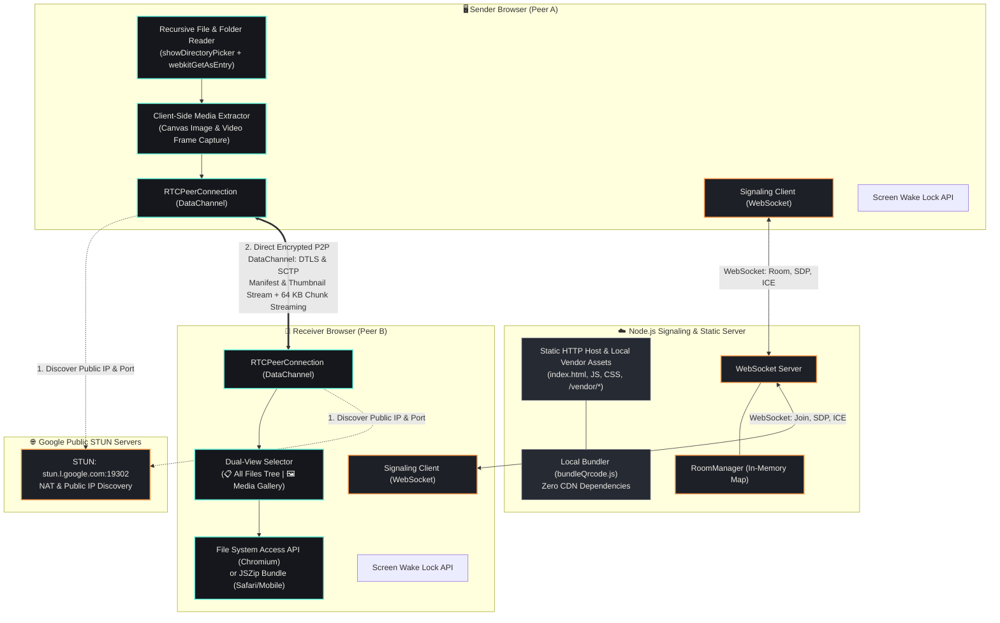

# ⚡ Relay — WebRTC Peer-to-Peer File & Folder Transfer

An ephemeral, browser-to-browser direct file sharing platform built with WebRTC. Files and nested folders stream directly between peers with end-to-end encryption, requiring zero cloud uploads, imposing no server storage limits, leaving zero footprint on intermediary servers, and operating with **zero external CDN dependencies**.

---

## 📌 1. What is this Project?

**Relay** is a web-based, zero-knowledge Peer-to-Peer (P2P) file and folder transfer tool powered by native **WebRTC `RTCDataChannel`** and modern browser streaming APIs. 

Traditional file-sharing tools force you to upload entire files to a cloud server (like Google Drive, WeTransfer, or Dropbox) before generating a download link. Relay eliminates the intermediary cloud server entirely: files and nested directory trees stream directly from the sender's disk to the receiver's disk through an encrypted direct channel.

---

## 🎯 2. Why Use It?

* **🔒 Absolute Privacy & Zero Trace:** Your files never touch a server, even temporarily. The central Node.js server only acts as a temporary "handshake broker" to exchange network addresses (SDP/ICE) and never sees file names, contents, or metadata.
* **📁 Multi-File & Nested Folder Support:** Drag-and-drop entire folders or select batches of files. The entire directory hierarchy and nested subfolder structures are preserved automatically.
* **🖼️ Dual-View Staging & Media Gallery:**
  * **📋 All Files Tab:** Full hierarchical folder tree with collapsible branches, file icons, and file sizes.
  * **🖼️ Media Tab:** Dedicated visual gallery for photos and videos, isolated from other documents. Media is grouped by parent folder with folder-level select buttons and individual card selection.
* **🎬 Instant In-Browser Image & Video Previews:**
  * **Images:** Instant high-speed thumbnail downscaling via HTML5 Canvas.
  * **Videos:** Automatic client-side video frame extraction (seeks to 1.0s timestamp, captures frame to canvas, and overlays a `▶ Video` badge with duration).
* **⚡ Progressive P2P Thumbnail Streaming:** The sender generates lightweight thumbnails (<32 KB per batch) and streams them over the WebRTC DataChannel ahead of the transfer. The receiver previews photos and videos live in the Media gallery *before* choosing which files to download.
* **📱 Mobile-Optimized Responsive Layout:**
  * **Mobile Phones (`≤ 480px`):** Fixed **2 media items per row** for an Instagram-like browsing experience on small screens.
  * **Desktops & Tablets:** Auto-filling adaptive grid with clean aspect-ratio cards.
* **🛡️ Zero External CDN Dependencies:** 100% self-contained. All client libraries (`qrcode`, `jsQR`, `jszip`) are served directly from the local server (`/vendor/`). Eliminates Microsoft Edge / Chrome / Safari / Firefox **Tracking Prevention** errors and enables transfers on air-gapped local networks.
* **📋 Smart Code Sanitization & Direct Links:**
  * Formatted codes (e.g., `C6E RRX` with spaces) or full URLs with hashes (`http://.../#C6ERRX`) are automatically sanitized and never truncated.
  * Shareable direct URL (`#CODE`) and high-resolution dynamic QR code generation/scanning.
* **📦 Direct-to-Disk & Universal ZIP Fallback:** 
  * On **Chromium Desktop** (Chrome, Edge, Brave, Opera), streams incoming chunks directly into chosen folders via `showDirectoryPicker()` with a flat ~10–20 MB memory footprint (unlimited file size).
  * On **Safari, Firefox, iOS, and Android**, bundles files client-side into a single `.zip` file with preserved folder hierarchy for an effortless 1-click download.
* **🔄 Non-Blocking State Resets:** Complete a transfer and immediately click **"Start New Transfer"** or **"Receive More Files"** without reloading the browser page.
* **🔋 Screen Wake Lock API:** Prevents mobile devices and laptops from sleeping mid-transfer (`navigator.wakeLock`).
* **🛡️ End-to-End Encryption (E2EE):** All WebRTC DataChannels are cryptographically protected out-of-the-box using **DTLS 1.2/1.3** and **SCTP**.

---

## ⚙️ 3. What Does It Do?

1. **Recursive Folder Ingestion:** Uses Chromium's `window.showDirectoryPicker()` alongside `webkitGetAsEntry()` batch readers and directory inputs to traverse arbitrary folder and subfolder depths on the sender.
2. **Media Extraction & Video Capture:** Client-side filters detect images and videos, generating lightweight thumbnails (data URLs) and isolating them into the dedicated Media Gallery tab.
3. **Two-Phase Manifest Protocol:**
   * **Phase A (Inventory & Thumbnails):** Sender transmits the file manifest and streams thumbnail packets in batches of 3 over WebRTC.
   * **Phase B (Selective Sync):** Receiver inspects the tree or media gallery, checks/unchecks items, and sends back a `manifest-ack` containing only the desired file IDs.
4. **Smart Backpressure Flow Control:** Streams files in 64 KiB chunks with high (8 MB) and low (1 MB) watermark buffer monitoring (`bufferedAmountLowThreshold`) to prevent memory spikes.
5. **Direct-to-Disk Streaming (Chromium):** Uses the **File System Access API** (`showDirectoryPicker` + `FileSystemWritableFileStream`) to write incoming bytes straight to disk, keeping memory consumption flat (~10–20 MB).
6. **Universal Fallback (Safari / Firefox / Mobile):** Assembles incoming chunks into an in-browser `.zip` archive via `JSZip`, triggering a single unified download that protects against mobile popup spam.
7. **Reactive Transfer UI:** Live per-file progress badges (`Pending`, `Downloading...`, `Received ✅`), overall byte counters, and a clean reset flow that requires no page refresh.

---

## 🏗️ 4. System Architecture

The architecture separates the **Control Plane (Signaling)** from the **Data Plane (P2P Transfer)**:



---

## 🔄 5. How P2P Works (Connection & Transfer Lifecycle)

```mermaid
sequenceDiagram
    autonumber
    actor Alice as 🖥️ Sender (Alice)
    participant Server as ☁️ Signaling Server (Node.js)
    actor Bob as 📱 Receiver (Bob)

    %% PHASE 1: PAIRING
    rect rgb(30, 35, 45)
    Note over Alice,Bob: Phase 1: Room Creation & Pairing (QR / Code / Hash URL)
    Alice->>Alice: Selects files or folders (e.g. project/ with photos, videos, code)
    Alice->>Alice: Generates client-side thumbnails for images & videos
    Alice->>Server: WS: {"type": "create-room"}
    Server->>Alice: WS: {"type": "room-created", "code": "C6ERRX"}
    Alice->>Alice: Renders QR Code, Room Code (C6E RRX) & Shareable Link (#C6ERRX)
    Bob->>Bob: Opens link relay.app/#C6ERRX, scans QR, or enters code
    Bob->>Server: WS: {"type": "join-room", "code": "C6ERRX"}
    Server->>Alice: WS: {"type": "receiver-joined"}
    Server->>Bob: WS: {"type": "room-joined", "code": "C6ERRX"}
    end

    %% PHASE 2: SIGNALING
    rect rgb(35, 40, 52)
    Note over Alice,Bob: Phase 2: WebRTC Signaling Handshake (Control Plane)
    Alice->>Alice: Creates RTCPeerConnection & DataChannel("file-transfer")
    Alice->>Alice: createOffer() -> setLocalDescription(offer)
    Alice->>Server: WS: {"type": "signal", "payload": {"sdp": offer}}
    Server->>Bob: WS: Relays SDP offer to Bob
    Bob->>Bob: setRemoteDescription(offer) -> createAnswer() -> setLocalDescription(answer)
    Bob->>Server: WS: {"type": "signal", "payload": {"sdp": answer}}
    Server->>Alice: WS: Relays SDP answer to Alice
    Alice->>Alice: setRemoteDescription(answer)

    par ICE Candidate Exchange
        Alice->>Server: WS: Candidate A (Public IP/Port)
        Server->>Bob: WS: Candidate A
        Bob->>Server: WS: Candidate B (Public IP/Port)
        Server->>Alice: WS: Candidate B
    end
    end

    %% PHASE 3: MANIFEST, THUMBNAILS & SELECTIVE SYNC
    rect rgb(20, 30, 35)
    Note over Alice,Bob: Phase 3: Manifest Exchange, Thumbnail Streaming & Selective Sync
    Alice->>Bob: 🔐 Direct DTLS 1.3 & SCTP Handshake (Peer-to-Peer)
    Note over Alice,Bob: ✅ RTCDataChannel OPEN
    Alice->>Bob: DataChannel: {"type": "manifest", "files": [...], "totalSize": 104857600}
    loop Streaming Thumbnail Packets
        Alice->>Bob: DataChannel: {"type": "thumbs", "items": [{id: 0, thumb: "..."}, ...]}
        Bob->>Bob: Live populates Media Gallery cards with thumbnails
    end
    Bob->>Bob: Receiver switches between "All Files" and "Media" tabs
    Bob->>Bob: User toggles folder-level or item checkboxes & clicks "Download Selected"
    Bob->>Alice: DataChannel: {"type": "manifest-ack", "accepted": true, "selectedIds": [0, 2]}
    end

    %% PHASE 4: CHUNK STREAMING
    rect rgb(25, 35, 40)
    Note over Alice,Bob: Phase 4: Sequential Chunk Streaming with Backpressure
    loop For Each Selected File
        Alice->>Bob: DataChannel: {"type": "file-start", "id": 0, "path": "photos/vacation.mp4", "size": ...}
        Bob->>Alice: DataChannel: {"type": "file-ready", "id": 0}
        loop Chunks with Flow Control
            Alice->>Alice: file.slice(offset, 64KB)
            Alice->>Bob: DataChannel: ArrayBuffer (64 KiB chunk)
            Bob->>Bob: Write chunk (showDirectoryPicker stream or JSZip)
        end
        Alice->>Bob: DataChannel: {"type": "file-end", "id": 0}
        Bob->>Alice: DataChannel: {"type": "file-ack", "id": 0}
    end
    Alice->>Bob: DataChannel: {"type": "all-done"}
    Note over Alice,Bob: Transfer Complete! Screen Wake Lock released.
    end
```



---

## 📂 6. Project Layout

```
webrtc-relay/
├── server/
│   ├── server.js            # HTTP host + WebSocket signaling relay + local /vendor/ routes
│   ├── package.json         # Node.js dependencies (ws, qrcode, jsqr, jszip) & postinstall bundler
│   └── lib/
│       ├── roomManager.js   # Ephemeral room manager & connection cleanup routines
│       ├── codeGenerator.js # Crypto-safe 6-character room codes
│       └── bundleQrcode.js  # Standalone zero-dependency UMD bundler for qrcode
└── client/
    ├── index.html           # UI layout with dual-view tabs & first-party vendor scripts
    ├── css/
    │   └── style.css        # Responsive dark-mode styling (2-column mobile media grid)
    └── js/
        ├── app.js           # Main coordinator & lifecycle orchestrator
        ├── signaling.js     # WebSocket signaling client wrapper
        ├── webrtc.js        # RTCPeerConnection & DataChannel wrapper
        ├── fileScanner.js   # Recursive folder scanner (showDirectoryPicker + webkitGetAsEntry)
        ├── fileTree.js      # Hierarchical tree builder & Media Gallery dual-view
        ├── fileTreeGroups.js# Groups media files by parent folder path
        ├── imageUtils.js    # Image & video detection, canvas resizing & video frame capture
        ├── fileTransfer.js  # Two-phase manifest protocol, thumbnail streaming & writers
        ├── wakeLock.js      # Screen Wake Lock API manager
        ├── qr.js            # Dynamic QR rendering & camera scanner
        ├── codeUtils.js     # Code formatting, URL parsing & whitespace sanitization
        └── ui.js            # DOM bindings & live progress formatters
```

---

## 🚀 7. Quick Start & Setup

### Prerequisites
* [Node.js](https://nodejs.org/) (v18+ recommended)

### 1. Install & Run Locally
```bash
# Navigate to the server folder
cd server

# Install dependencies (ws, qrcode, jsqr, jszip)
# The postinstall script automatically bundles qrcode into /vendor/
npm install

# Start the server
npm start
# -> Signaling + static server listening on http://localhost:3000
```

### 2. Testing Across Local Devices (LAN / Wi-Fi)
1. Find your host computer's Local IP address (e.g. `192.168.1.50`).
2. Open `http://localhost:3000` on your host computer.
3. Open `http://192.168.1.50:3000` on your smartphone, tablet, or secondary computer.
4. **QR Camera Scanning Note:** Modern mobile browsers require **HTTPS** (or `localhost`) to grant camera access. For testing camera QR scanning across devices over Wi-Fi/WAN, run a secure TLS tunnel:
   ```bash
   npx ngrok http 3000
   ```

---

## 💡 8. Browser Compatibility & Technical Highlights

| Feature | Chromium (Chrome, Edge, Brave, Opera) | Firefox / Safari / Mobile (iOS & Android) |
| :--- | :--- | :--- |
| **Multi-File & Folder Transfer** | Full Support (`showDirectoryPicker` + drag-and-drop) | Full Support (`webkitGetAsEntry` + directory input) |
| **Max Transfer Size** | **Unlimited** (flat ~10–20 MB memory footprint) | Bounded by device memory (~1–2 GB) |
| **Folder Save Destination** | `showDirectoryPicker()` (saves directly into disk folder) | Bundles into single `.zip` file via `JSZip` |
| **Media Gallery & Video Previews** | Full Support (canvas downscaling + video frame capture) | Full Support (canvas downscaling + video frame capture) |
| **Mobile Media Grid** | Responsive 2-column grid (`repeat(2, 1fr)`) | Responsive 2-column grid (`repeat(2, 1fr)`) |
| **P2P Thumbnail Streaming** | Progressive streaming (<32 KB per packet over SCTP) | Progressive streaming (<32 KB per packet over SCTP) |
| **Selective Sync Controls** | Folder-level checkboxes & individual item checkboxes | Folder-level checkboxes & individual item checkboxes |
| **Zero-CDN Architecture** | Served locally from `/vendor/` (Zero Tracking Blocks) | Served locally from `/vendor/` (Zero Tracking Blocks) |
| **Code Input Sanitization** | Auto-strips spaces & URLs (handles `C6E RRX` / `#CODE`) | Auto-strips spaces & URLs (handles `C6E RRX` / `#CODE`) |
| **Screen Wake Lock** | Native `navigator.wakeLock` supported | Native `navigator.wakeLock` supported |
| **Data Encryption** | DTLS 1.2 / 1.3 (Mandatory WebRTC E2EE) | DTLS 1.2 / 1.3 (Mandatory WebRTC E2EE) |
| **Non-Reload State Reset** | "Start New Transfer" / "Receive More Files" without refresh | "Start New Transfer" / "Receive More Files" without refresh |
