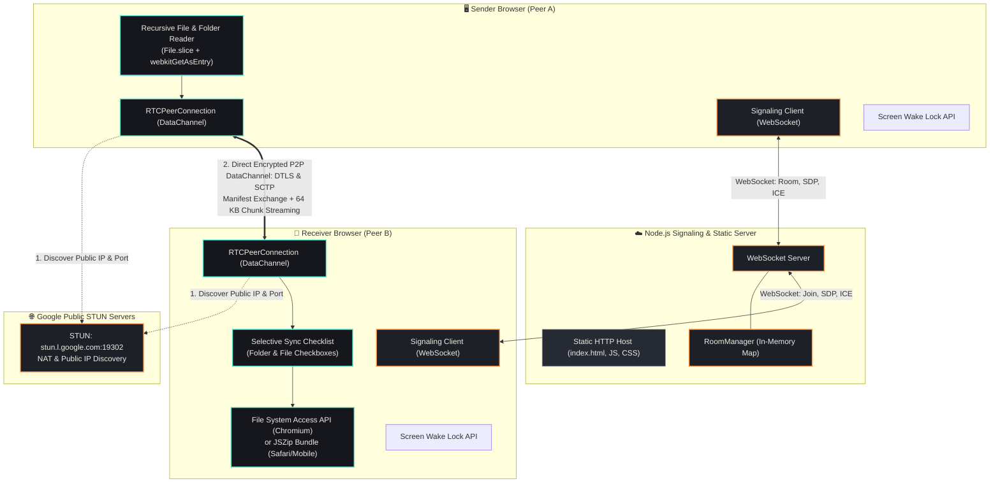

# ⚡ Relay — WebRTC Peer-to-Peer File & Folder Transfer

An ephemeral, browser-to-browser direct file sharing platform built with WebRTC. Files and nested folders stream directly between peers with end-to-end encryption, requiring zero uploads, imposing no server storage limits, and leaving zero footprint on intermediary servers.

---

## 📌 1. What is this Project?

**Relay** is a web-based, zero-knowledge Peer-to-Peer (P2P) file and folder transfer tool powered by native **WebRTC `RTCDataChannel`** and modern browser streaming APIs. 

Traditional file-sharing tools force you to upload entire files to a cloud server (like Google Drive, WeTransfer, or Dropbox) before generating a download link. Relay eliminates the intermediary cloud server entirely: files and nested directory trees stream directly from the sender's disk to the receiver's disk through an encrypted direct channel.

---

## 🎯 2. Why Use It?

* **🔒 Absolute Privacy & Zero Trace:** Your files never touch a server, even temporarily. The central Node.js server only acts as a temporary "handshake broker" to exchange network addresses (SDP/ICE) and never sees file names, contents, or metadata.
* **📁 Multi-File & Nested Folder Support:** Drag-and-drop entire folders or select batches of files. The folder hierarchy and subfolder structures are preserved automatically.
* **☑️ Receiver Selective Sync:** Receiver previews the staged folder/file tree with folder-level checkboxes (with tri-state indeterminate support) and individual file checkboxes, downloading only what they want.
* **📦 Direct-to-Disk & Universal ZIP Fallback:** On Chromium desktop, streams directly into chosen folders via `showDirectoryPicker()`. On Safari, Firefox, iOS, and Android, bundles files client-side into a single `.zip` file for an effortless 1-click download.
* **🔋 Screen Wake Lock API:** Prevents mobile devices and laptops from sleeping mid-transfer (`navigator.wakeLock`).
* **🔗 Shareable Direct Links (`#CODE`):** One-click copyable URL (`relay.app/#KP34EE`) that automatically connects the receiver without manual typing.
* **📱 Instant Pairing via QR or 6-Char Code:** No accounts, no logins, no phone numbers. Share a 6-character code, copy a link, or scan a dynamic QR code.
* **⚡ Blazing Fast Speeds:** When devices are on the same local network (Wi-Fi or LAN), transfers achieve raw local network speeds without consuming internet bandwidth.
* **🛡️ End-to-End Encryption (E2EE):** All WebRTC DataChannels are cryptographically protected out-of-the-box using **DTLS 1.2/1.3** and **SCTP**.

---

## ⚙️ 3. What Does It Do?

1. **Recursive Folder Ingestion:** Uses `webkitGetAsEntry()` batch readers and directory inputs to traverse arbitrary folder and subfolder depths on the sender.
2. **Two-Phase Manifest Protocol:** Sender shares the file inventory (`manifest`), and the receiver sends back an acknowledgement (`manifest-ack`) selecting exact files to download.
3. **Smart Backpressure Flow Control:** Streams files in 64 KiB chunks with high (8 MB) and low (1 MB) watermark buffer monitoring (`bufferedAmountLowThreshold`) to prevent memory spikes.
4. **Direct-to-Disk Streaming (Chromium):** Uses the **File System Access API** (`showDirectoryPicker` + `FileSystemWritableFileStream`) to write incoming bytes straight to disk, keeping memory consumption flat (~10–20 MB).
5. **Universal Fallback (Safari / Firefox / Mobile):** Assembles incoming chunks into an in-memory or streamed `.zip` archive via `JSZip`, triggering a single unified download.
6. **Reactive Transfer UI & Zero-Reload State Management:** Provides per-file progress badges (`Pending`, `Downloading...`, `Received ✅`), overall byte counters, and a clean "Start New Transfer" state reset that requires no page refresh.

---

## 🏗️ 4. System Architecture

The architecture separates the **Control Plane (Signaling)** from the **Data Plane (P2P Transfer)**:



---

## 🔄 5. How P2P Works (Connection & Transfer Lifecycle)

```mermaid
sequenceDiagram
    autonumber
    actor Alice as 🖥️ Sender (Alice)
    participant Server as ☁️ Signaling Server (Node.js)
    actor Bob as 📱 Receiver (Bob)

    %% PHASE 1: PAIRING
    rect rgb(30, 35, 45)
    Note over Alice,Bob: Phase 1: Room Creation & Pairing (QR / Code / Hash URL)
    Alice->>Alice: Selects files or folders (e.g. project/ with subfolders)
    Alice->>Server: WS: {"type": "create-room"}
    Server->>Alice: WS: {"type": "room-created", "code": "KQ34EE"}
    Alice->>Alice: Renders QR Code, Room Code & Shareable Link (#KQ34EE)
    Bob->>Bob: Opens link relay.app/#KQ34EE or scans QR code
    Bob->>Server: WS: {"type": "join-room", "code": "KQ34EE"}
    Server->>Alice: WS: {"type": "receiver-joined"}
    Server->>Bob: WS: {"type": "room-joined", "code": "KQ34EE"}
    end

    %% PHASE 2: SIGNALING
    rect rgb(35, 40, 52)
    Note over Alice,Bob: Phase 2: WebRTC Signaling Handshake (Control Plane)
    Alice->>Alice: Creates RTCPeerConnection & DataChannel("file-transfer")
    Alice->>Alice: createOffer() -> setLocalDescription(offer)
    Alice->>Server: WS: {"type": "signal", "payload": {"sdp": offer}}
    Server->>Bob: WS: Relays SDP offer to Bob
    Bob->>Bob: setRemoteDescription(offer) -> createAnswer() -> setLocalDescription(answer)
    Bob->>Server: WS: {"type": "signal", "payload": {"sdp": answer}}
    Server->>Alice: WS: Relays SDP answer to Alice
    Alice->>Alice: setRemoteDescription(answer)

    par ICE Candidate Exchange
        Alice->>Server: WS: Candidate A (Public IP/Port)
        Server->>Bob: WS: Candidate A
        Bob->>Server: WS: Candidate B (Public IP/Port)
        Server->>Alice: WS: Candidate B
    end
    end

    %% PHASE 3: MANIFEST & SELECTIVE SYNC
    rect rgb(20, 30, 35)
    Note over Alice,Bob: Phase 3: Manifest Exchange & Selective Sync
    Alice->>Bob: 🔐 Direct DTLS 1.3 & SCTP Handshake (Peer-to-Peer)
    Note over Alice,Bob: ✅ RTCDataChannel OPEN
    Alice->>Bob: DataChannel: {"type": "manifest", "files": [...], "totalSize": 104857600}
    Bob->>Bob: Displays interactive folder/file tree with checkboxes
    Bob->>Bob: User checks/unchecks items & selects save destination
    Bob->>Alice: DataChannel: {"type": "manifest-ack", "accepted": true, "selectedIds": [0, 2]}
    end

    %% PHASE 4: CHUNK STREAMING
    rect rgb(25, 35, 40)
    Note over Alice,Bob: Phase 4: Sequential Chunk Streaming with Backpressure
    loop For Each Selected File
        Alice->>Bob: DataChannel: {"type": "file-start", "id": 0, "path": "src/app.js", "size": ...}
        Bob->>Alice: DataChannel: {"type": "file-ready", "id": 0}
        loop Chunks with Flow Control
            Alice->>Alice: file.slice(offset, 64KB)
            Alice->>Bob: DataChannel: ArrayBuffer (64 KiB chunk)
            Bob->>Bob: Write chunk (showDirectoryPicker stream or JSZip)
        end
        Alice->>Bob: DataChannel: {"type": "file-end", "id": 0}
        Bob->>Alice: DataChannel: {"type": "file-ack", "id": 0}
    end
    Alice->>Bob: DataChannel: {"type": "all-done"}
    Note over Alice,Bob: Transfer Complete! Screen Wake Lock released.
    end
```



---

## 📂 6. Project Layout

```
webrtc-relay/
├── server/
│   ├── server.js            # HTTP static host + WebSocket signaling relay
│   ├── package.json         # Node.js dependencies
│   └── lib/
│       ├── roomManager.js   # Ephemeral room manager & cleanup routines
│       └── codeGenerator.js # Crypto-safe 6-character room codes
└── client/
    ├── index.html           # UI layout with responsive trees & CDN scripts
    ├── css/
    │   └── style.css        # Responsive dark-mode styling (mobile + laptop)
    └── js/
        ├── app.js           # Main coordinator & lifecycle orchestrator
        ├── signaling.js     # WebSocket signaling client wrapper
        ├── webrtc.js        # RTCPeerConnection & DataChannel wrapper
        ├── fileScanner.js   # Recursive drag-and-drop & folder entry scanner
        ├── fileTree.js      # Hierarchical tree builder & sync checkboxes
        ├── fileTransfer.js  # Manifest protocol, chunk streaming & writers
        ├── wakeLock.js      # Screen Wake Lock API manager
        ├── qr.js            # QR rendering & camera scanner
        ├── codeUtils.js     # Code formatting & sanitization helpers
        └── ui.js            # DOM bindings & progress formatters
```

---

## 🚀 7. Quick Start & Setup

### Prerequisites
* [Node.js](https://nodejs.org/) (v16+ recommended)

### 1. Install & Run Locally
```bash
# Navigate to the server folder
cd server

# Install dependencies (ws)
npm install

# Start the server
npm start
# -> Signaling + static server listening on http://localhost:3000
```

### 2. Testing across different devices
1. Find your host computer's Local IP address (e.g. `192.168.1.50`).
2. Open `http://localhost:3000` on your computer.
3. Open `http://192.168.1.50:3000` on your mobile device or second computer.
4. **Camera / QR scanning note:** Modern mobile browsers require **HTTPS** (or `localhost`) to grant camera access. For scanning across multiple physical devices over WAN/Wi-Fi, run a TLS reverse proxy (e.g. ngrok, Caddy, or Cloudflare Tunnel):
   ```bash
   npx ngrok http 3000
   ```

---

## 💡 8. Browser Compatibility & Technical Highlights

| Feature | Chromium (Chrome, Edge, Brave, Opera) | Firefox / Safari / Mobile |
| :--- | :--- | :--- |
| **Multi-File & Folder Transfer** | Full Support (drag-and-drop + directory picker) | Full Support (drag-and-drop + folder picker) |
| **Max Transfer Size** | **Unlimited** (flat ~10–20 MB memory footprint) | Bounded by device memory (~2–4 GB) |
| **Folder Save Destination** | `showDirectoryPicker()` (saves directly to chosen disk folder) | Bundles into single `.zip` file via `JSZip` |
| **Selective Sync Tree** | Interactive folder-level and individual file checkboxes | Interactive folder-level and individual file checkboxes |
| **Screen Wake Lock** | Native `navigator.wakeLock` supported | Native `navigator.wakeLock` supported |
| **Data Encryption** | DTLS 1.2 / 1.3 (Mandatory WebRTC E2EE) | DTLS 1.2 / 1.3 (Mandatory WebRTC E2EE) |
| **P2P Transport** | SCTP over DTLS (`RTCDataChannel`) | SCTP over DTLS (`RTCDataChannel`) |
