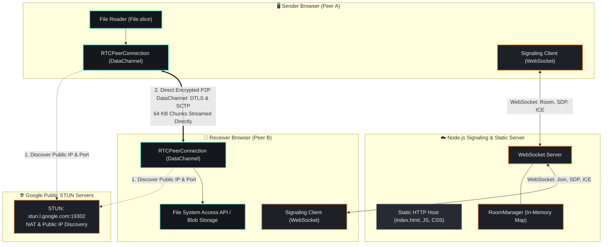

# ⚡ Relay — WebRTC Peer-to-Peer File Transfer

An ephemeral, browser-to-browser direct file sharing platform built with WebRTC. Files stream directly between peers with end-to-end encryption, requiring zero uploads, imposing no server storage limits, and leaving zero footprint on intermediary servers.

---

## 📌 1. What is this Project?

**Relay** is a web-based, zero-knowledge Peer-to-Peer (P2P) file transfer tool powered by native **WebRTC `RTCDataChannel`** and modern browser streaming APIs. 

Traditional file-sharing tools force you to upload an entire file to a cloud server (like Google Drive, WeTransfer, or Dropbox) before generating a download link. Relay eliminates the intermediary cloud server entirely: files stream directly from the sender's disk to the receiver's disk through an encrypted direct channel.

---

## 🎯 2. Why Use It?

* **🔒 Absolute Privacy & Zero Trace:** Your files never touch a server, even temporarily. The central Node.js server only acts as a temporary "handshake broker" to exchange network addresses (SDP/ICE) and never sees file names, contents, or metadata.
* **📦 No File Size Limits:** Because files stream directly to disk without consuming intermediate RAM on Chromium browsers, you can send 1 GB, 50 GB, or 100 GB files without browser tab crashes.
* **⚡ Blazing Fast Speeds:** When both devices are on the same local network (Wi-Fi or LAN), transfers achieve raw local network speeds without consuming internet bandwidth.
* **🛡️ End-to-End Encryption (E2EE):** All WebRTC DataChannels are cryptographically protected out-of-the-box using **DTLS 1.2/1.3** and **SCTP**.
* **📱 Instant Pairing via QR or 6-Char Code:** No accounts, no logins, no phone numbers. Just share a 6-character code or scan a QR code with your mobile camera.

---

## ⚙️ 3. What Does It Do?

1. **Ephemeral Room Generation:** Generates crypto-safe, collision-free 6-character room codes with 10-minute auto-expiry.
2. **Integrated QR Code Generation & Scanning:** Generates dynamic QR codes in-browser (using `qrcode`) and scans via the receiver's camera (using `jsQR` with `getUserMedia`).
3. **Smart Backpressure Flow Control:** Streams files in 64 KiB chunks with high (8 MB) and low (1 MB) watermark buffer monitoring (`bufferedAmountLowThreshold`) to prevent memory leaks on fast senders with slow receivers.
4. **Direct-to-Disk Streaming (Chromium):** Uses the **File System Access API** (`showSaveFilePicker` + `FileSystemWritableFileStream`) to write incoming bytes straight to disk, keeping memory consumption flat (~10–20 MB).
5. **Universal Fallback (Safari / Firefox):** Gracefully falls back to in-memory chunk buffering and Blob URL generation for browsers without the File System Access API.

---

## 🏗️ 4. System Architecture

The architecture separates the **Control Plane (Signaling)** from the **Data Plane (P2P Transfer)**:



---

## 🔄 5. How P2P Works (Connection & Transfer Lifecycle)

The entire transfer lifecycle proceeds through 4 distinct phases:

```mermaid
sequenceDiagram
    autonumber
    actor Alice as 🖥️ Sender (Alice)
    participant Server as ☁️ Signaling Server (Node.js)
    actor Bob as 📱 Receiver (Bob)

    %% PHASE 1: PAIRING
    rect rgb(30, 35, 45)
    Note over Alice,Bob: Phase 1: Room Creation & QR Pairing
    Alice->>Alice: Selects file (e.g. video.mp4, 2 GB)
    Alice->>Server: WS: {"type": "create-room"}
    Server->>Alice: WS: {"type": "room-created", "code": "KQ34EE"}
    Alice->>Alice: Renders QR Code & 6-character room code
    Bob->>Alice: Scans QR code with camera (or enters "KQ34EE")
    Bob->>Server: WS: {"type": "join-room", "code": "KQ34EE"}
    Server->>Alice: WS: {"type": "receiver-joined"}
    Server->>Bob: WS: {"type": "room-joined", "code": "KQ34EE"}
    end

    %% PHASE 2: SIGNALING
    rect rgb(35, 40, 52)
    Note over Alice,Bob: Phase 2: WebRTC Signaling Handshake (Control Plane)
    Alice->>Alice: Creates RTCPeerConnection & DataChannel("file-transfer")
    Alice->>Alice: createOffer() -> setLocalDescription(offer)
    Alice->>Server: WS: {"type": "signal", "payload": {"sdp": offer}}
    Server->>Bob: WS: Relays SDP offer to Bob
    Bob->>Bob: setRemoteDescription(offer) -> createAnswer() -> setLocalDescription(answer)
    Bob->>Server: WS: {"type": "signal", "payload": {"sdp": answer}}
    Server->>Alice: WS: Relays SDP answer to Alice
    Alice->>Alice: setRemoteDescription(answer)

    par ICE Candidate Exchange
        Alice->>Server: WS: Candidate A (Public IP/Port)
        Server->>Bob: WS: Candidate A
        Bob->>Server: WS: Candidate B (Public IP/Port)
        Server->>Alice: WS: Candidate B
    end
    end

    %% PHASE 3 & 4: DIRECT P2P
    rect rgb(20, 30, 35)
    Note over Alice,Bob: Phase 3 & 4: Direct P2P File Streaming (Data Plane)
    Alice->>Bob: 🔐 Direct DTLS 1.3 & SCTP Handshake (Peer-to-Peer)
    Note over Alice,Bob: ✅ RTCDataChannel OPEN (Signaling server no longer involved)

    Alice->>Bob: DataChannel: {"type": "meta", "name": "video.mp4", "size": 2147483648}
    Bob->>Bob: Prompts user: showSaveFilePicker() -> creates disk stream
    Bob->>Alice: DataChannel: {"type": "ready"}

    loop Chunk Streaming with Backpressure
        Alice->>Alice: file.slice(offset, 64KB)
        Alice->>Bob: DataChannel: ArrayBuffer (64 KiB chunk)
        Bob->>Bob: streamWriter.write(chunk) -> Saves to Disk
    end

    Alice->>Bob: DataChannel: {"type": "end"}
    Bob->>Bob: streamWriter.close() -> Transfer Complete!
    end
```



---

## 📂 6. Project Layout

```
webrtc-relay/
├── server/
│   ├── server.js            # HTTP static host + WebSocket signaling relay
│   ├── package.json         # Node.js dependencies
│   └── lib/
│       ├── roomManager.js   # Ephemeral room manager & cleanup routines
│       └── codeGenerator.js # Crypto-safe 6-character room codes
└── client/
    ├── index.html           # Minimal UI layout & CDN scripts
    ├── css/
    │   └── style.css        # Clean dark-mode stylesheet
    └── js/
        ├── app.js           # Main application coordinator
        ├── signaling.js     # WebSocket signaling client wrapper
        ├── webrtc.js        # RTCPeerConnection & DataChannel wrapper
        ├── fileTransfer.js  # Chunk streaming, backpressure & disk writers
        ├── qr.js            # In-browser QR rendering & camera scanner
        ├── codeUtils.js     # Code formatting & sanitization helpers
        └── ui.js            # DOM bindings & UI state handlers
```

---

## 🚀 7. Quick Start & Setup

### Prerequisites
* [Node.js](https://nodejs.org/) (v16+ recommended)

### 1. Install & Run Locally
```bash
# Navigate to the server folder
cd server

# Install dependencies (ws)
npm install

# Start the server
npm start
# -> Signaling + static server listening on http://localhost:3000
```

### 2. Testing across different devices
1. Find your host computer's Local IP address (e.g. `192.168.1.50`).
2. Open `http://localhost:3000` on your computer.
3. Open `http://192.168.1.50:3000` on your mobile device or second computer.
4. **Camera / QR scanning note:** Modern mobile browsers require **HTTPS** (or `localhost`) to grant camera access. For scanning across multiple physical devices over WAN/Wi-Fi, run a TLS reverse proxy (e.g. ngrok, Caddy, or Cloudflare Tunnel):
   ```bash
   npx ngrok http 3000
   ```

---

## 💡 8. Browser Compatibility & Technical Highlights

| Feature | Chromium (Chrome, Edge, Brave, Opera) | Firefox / Safari |
| :--- | :--- | :--- |
| **Max File Size** | **Unlimited** (bounded only by free disk space) | Bounded by available tab RAM (~2–4 GB) |
| **Save Destination** | Native Save Dialog (`showSaveFilePicker`) | Browser Download Directory |
| **Data Encryption** | DTLS 1.2 / 1.3 (Mandatory WebRTC E2EE) | DTLS 1.2 / 1.3 (Mandatory WebRTC E2EE) |
| **P2P Transport** | SCTP over DTLS (`RTCDataChannel`) | SCTP over DTLS (`RTCDataChannel`) |
