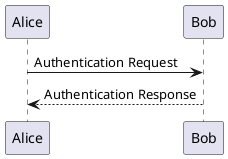
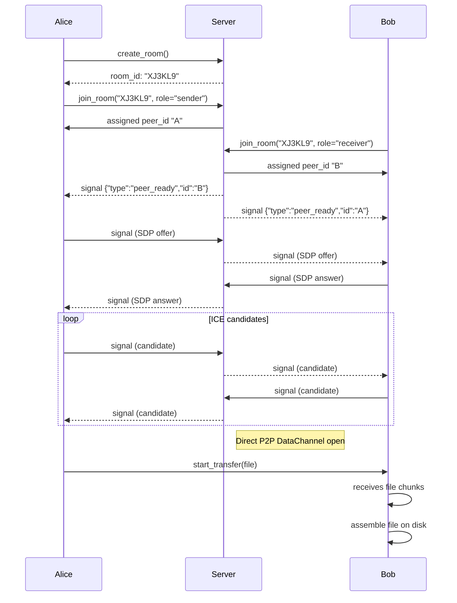
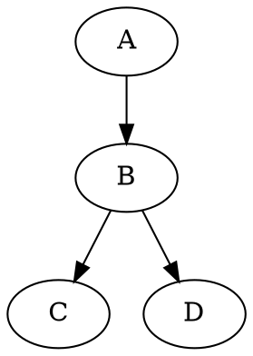

```d2
client -> api: GET /users
api -> db: Query
db -> api: Records
api -> client: JSON Response
```





```wavedrom
{ "signal": [
  { "name": "clk", "wave": "p....." },
  { "name": "data", "wave": "x345x.", "data": ["head", "body", "tail"] }
]}
```